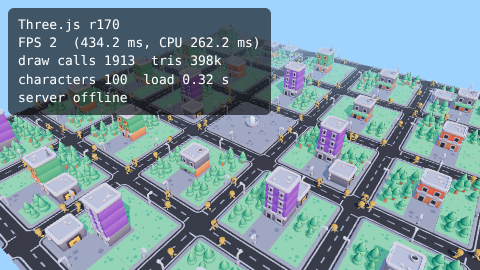
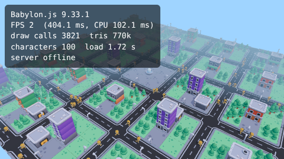
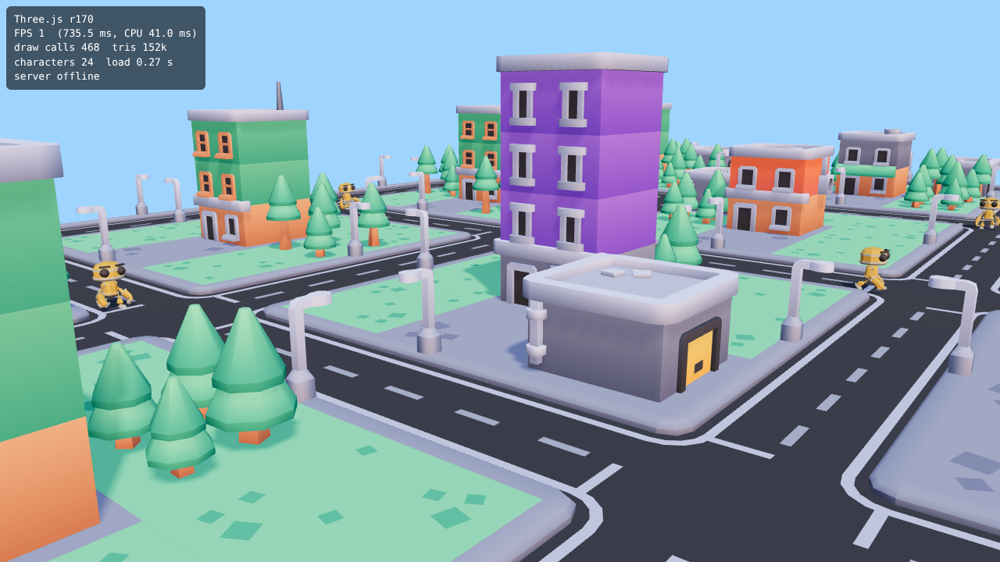
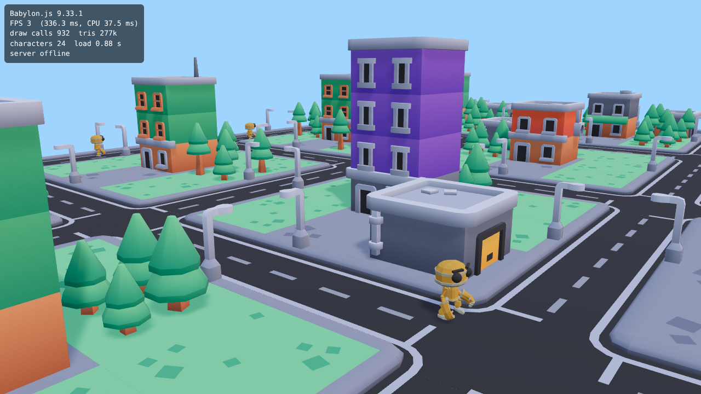

# Engine test: Three.js vs Babylon.js (2026-10-31)

Moiz asked whether to switch game engines because the graphics look bad. Instead of arguing,
we built the same scene in both engines and compared them.

## What was built

`proto/engines/` draws one scene twice, with the same code for everything except the renderer:

- A 5x5 block town from free CC0 models (Kenney City Builder kit): roads, lamp posts, cribs, yards, trees, a plaza with a fountain.
- 24 animated, skinned characters (Quaternius "RobotExpressive", CC0) walking around the blocks.
- The same lighting in both: sky fill light, one sun with soft shadows, an HDR sky for reflections (Poly Haven, CC0), ACES tone mapping, fog.
- Both pages sign in as a guest and join quick play on the **real Bro Chase server**, so WASD moves your bro and live bots and Opps show up. The server and `shared/` code didn't change at all.

Run it on your own computer (you need `npm install` once, for Babylon.js):

```
git pull && npm install && npm run build && npm start
# second terminal:
npm run proto
```

Then open http://localhost:5174 and pick an engine. Add `?n=60` for more characters, `?cam=close` for a street-level view, `?online=0` to skip the server.

## Screenshots

| Three.js (what we use now) | Babylon.js |
| --- | --- |
|  |  |
|  |  |

They look almost the same. The look comes from the models and the lighting, not from the engine.

## Numbers

Measured in the cloud with headless Chrome. It has **no graphics card** (software rendering), so FPS there is 1 to 3 in
both engines and is not a fair FPS number. Open the test on your Mac for real FPS; the counter is in the top-left corner.

| | Three.js r170 | Babylon.js 9.33 |
| --- | --- | --- |
| Download size of the engine code (gzipped) | **152 KB** | 763 KB (5x bigger) |
| Time to load the scene | **0.27 s** | 0.88 s |
| Draw calls, same scene | **468** | 932 |
| FPS without a graphics card (24 characters) | 2.8 | 1.2 |
| FPS without a graphics card (100 characters) | 2.5 | 2.2 |
| Looks | same | same |

Neither engine is clearly faster. Babylon.js is bigger and slower to load, and draws the same scene with twice the draw calls on default settings.

## What switching would cost

- Rewrite the 8 client files that use Three.js directly: `render.ts`, `avatar.ts`, `upgrades.ts`, `creator.ts` and the `fx/` effects.
  That is about 2,950 lines and about 460 Three.js calls.
- The server, `shared/` rules, HUD, input, audio, accounts and lobbies would not change.
- While the rewrite runs, the graphics work (real models) would have to pause or be done twice.
- Every feature that draws something (doors, defences, gear looks, kill effects, vents, the character creator) would need testing again.

**Unity or Godot web builds** would be a much bigger change: a rewrite of the whole client in another language,
a 10 to 30 MB download before the game starts, slower start on phones, and the multiplayer code done again. Not worth it for a browser game.

## Decision

**2026-10-31: Moiz chose to switch to Babylon.js.** The recommendation below was to stay; the switch is planned in 3 PRs (see MEMORY.md).

## Recommendation (before the decision)

**Stay on Three.js.** Babylon.js gives the same picture, not a better one, at the cost of a full client rewrite and a 5x bigger download.
What makes the game look better is real 3D models, good lighting and animated characters, which is what the graphics thread is building now in Three.js.
The test shows that free models like these already lift the look a lot.
